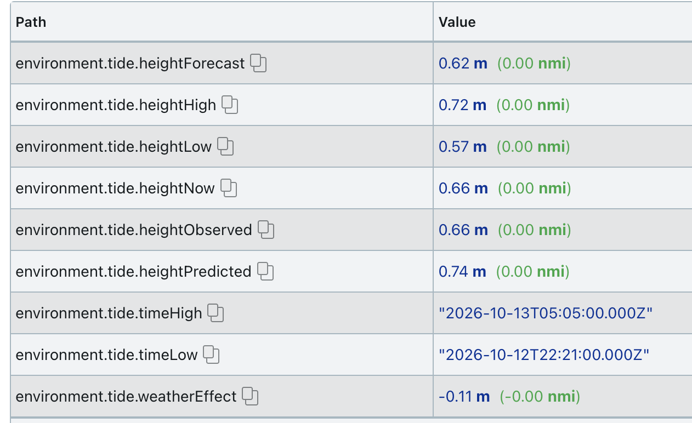

# signalk-tides-API

This is a copy of sbender9's derived-data.

Currently serving worldtide.info API, NOAA free data, Kartverket (Norway), DMI (Denmark), Rijkswaterstaat (Netherlands) and CHS (Canada) free data, measured and forecast sea level from SMHI (Sweden) and FMI (Finland), the Open-Meteo marine model worldwide, and offline harmonic predictions computed on the boat. It can potentially serve other APIs and web sources for tidal data. Please feel free to contribute

> **Coming back from signalk-tides?** In 2025 this plugin stopped producing data on newer servers
> (#67), and [signalk-tides](https://www.npmjs.com/package/signalk-tides) by @bkeepers was published
> as a rewrite. Version 0.4.0 of this plugin fixes that: providers now update on an interval (#73),
> it starts without a GPS fix, and it adds a free Kartverket provider for Norway with forecast and
> observed water levels. Both plugins are maintained; pick the one whose providers suit your area.
> See the [changelog](CHANGELOG.md).

## Providers

Enable one provider under *Tides* in the plugin configuration.

| Provider | Area | Key needed |
|---|---|---|
| NOAA | US only | no |
| worldtides.info | worldwide | yes, paid |
| Kartverket | Norway | no |
| DMI | Denmark, Greenland, Faroe Islands | no |
| Rijkswaterstaat | Netherlands | no |
| CHS | Canada | no |
| SMHI | Sweden (measured sea level only) | no |
| FMI | Finland (sea level forecast and measurements) | no |
| Open-Meteo | worldwide (ocean model, not for coastal navigation) | no |
| Offline predictions | worldwide, no internet (needs the optional `neaps` package) | no |

Kartverket and DMI only publish data where they have it, so a boat sailing between Norway and Denmark
can enable both. Where both have data (parts of the Skagerrak), both publish to the same paths; enable
the one for the waters you are in. The same goes for the other national providers.

Open-Meteo and the offline predictions work almost anywhere but are less precise than a national
service's own station. They can be enabled together with a national provider: while a station-based
provider publishes tide values, the fallbacks publish none (so the two don't take turns on the same paths)
and only answer the `tides` resource when the station-based providers can't; 10 minutes after the
station-based providers stop (e.g. out of their area), the fallbacks publish again.

### Kartverket (Norway)

Uses the free water level API of Kartverket, the Norwegian Mapping Authority
(https://vannstand.kartverket.no/tideapi_en.html), queried for the boat's position
(`tide_request=locationdata`).



Published paths (heights in metres above the chosen reference level, times in UTC ISO 8601):

| Path | Contents |
|---|---|
| `environment.tide.heightHigh`, `environment.tide.timeHigh` | next high tide |
| `environment.tide.heightLow`, `environment.tide.timeLow` | next low tide |
| `environment.tide.heightNow` | water level now: observed if Kartverket has an observation at the boat's position, otherwise Kartverket's forecast (astronomical tide plus weather effect), otherwise the astronomical prediction |
| `environment.tide.heightPredicted` | astronomical tide now (not in the Signal K specification) |
| `environment.tide.heightForecast` | forecast water level now, including wind and air pressure (not in the specification) |
| `environment.tide.weatherEffect` | forecast minus prediction, i.e. the effect of wind and pressure (not in the specification) |
| `environment.tide.heightObserved` | latest observed water level, not older than 3 hours (not in the specification) |

In the Oslofjord and Skagerrak the astronomical tide is small (about 30 cm range at Fredrikstad),
so wind and air pressure often matter more. Compare `heightForecast` or `heightObserved` with `heightPredicted`.

Options:

| Option | Default | |
|---|---|---|
| Reference level | Chart datum (CD) | `CD` chart datum (sjøkartnull), `MSL` mean sea level, `NN2000` Norwegian height datum |
| Minutes between water level updates | 30 | minimum 10 |
| Station latitude / longitude | empty | position of a Kartverket tide gauge (find it on https://kartverket.no/en/at-sea/se-havniva). Usually not needed: where Kartverket derives a position's tide from a nearby gauge, it also returns that gauge's observations (Fredrikstad gets Viker's, shifted 5 minutes and scaled by 1.03). Set this only if `heightObserved` stays empty for your area. Costs one extra request per update. |
| API address | `https://vannstand.kartverket.no/tideapi.php` | change only if Kartverket moves the service (it used to be `api.sehavniva.no`) |

Requests and caching: the high/low table is requested again only after the next high or low tide has
passed (or when the boat has moved more than 5 km); the hourly water levels are requested at the update
interval. Between requests the cached values are re-published every minute, so `heightNow` keeps changing
without extra load on the service. After a failed request the provider waits 5 minutes, then 10, 20 and so on,
up to the update interval (at least 30 minutes); a position Kartverket has no data for is asked again only once per interval.
Every request carries a `signalk-tides-api/<version>` User-Agent, as Kartverket asks API users to keep
requests to a minimum.

Attribution: water level data from Kartverket, Norwegian Mapping Authority, Hydrographic Service,
licensed under [CC BY 4.0](https://creativecommons.org/licenses/by/4.0/). Credit Kartverket when you show
or share the data.

### DMI (Denmark, Greenland, Faroe Islands)

Uses the free oceanographic API of DMI, the Danish Meteorological Institute
(https://www.dmi.dk/friedata/dokumentation/apis/oceanographic-observation-and-tidewater-api): tide
predictions for about 220 stations, and sea level measured every 10 minutes at DMI's tide gauges.
The provider uses the nearest prediction station and the tide gauge at the same place.

| Path | Contents |
|---|---|
| `environment.tide.heightHigh`, `environment.tide.timeHigh` | next high tide at the station |
| `environment.tide.heightLow`, `environment.tide.timeLow` | next low tide at the station |
| `environment.tide.heightNow` | measured water level if the gauge reported in the last hour, otherwise the prediction |
| `environment.tide.heightPredicted` | astronomical tide now (not in the Signal K specification) |
| `environment.tide.heightObserved` | latest measured water level at the gauge (not in the specification) |
| `environment.tide.weatherEffect` | measured minus predicted at the time of the measurement: the effect of wind and air pressure (not in the specification) |

In the Baltic the astronomical tide is a few centimetres to a few decimetres, and wind and air pressure
change the water level far more; `heightObserved` and `weatherEffect` show that. At Esbjerg on the North
Sea coast the tide range is close to 2 m.

Options:

| Option | Default | |
|---|---|---|
| Reference level | DVR90 | `DVR90` is the Danish height datum (a land datum close to mean sea level, so low tides are often negative). `LAT` gives heights above the station's lowest astronomical tide, as published by DMI for each station. |
| Minutes between measured water level updates | 10 | minimum 10, DMI's measuring interval |
| Use the nearest tide station within (km) | 50 | outside this distance the provider publishes nothing |
| API address | `https://opendataapi.dmi.dk/v2/oceanObs/collections` | |

Requests: the station lists once a month (kept in `dmi-stations.json` in the plugin's data folder), the
highs and lows for 7 days and the 10-minute prediction for 2 days only when they are about to run out or
the nearest station changes, and the latest measurement at the update interval.

Attribution: data from the Danish Meteorological Institute (DMI), licensed under
[CC BY 4.0](https://creativecommons.org/licenses/by/4.0/).

### Rijkswaterstaat (Netherlands)

Uses the free WaterWebservices of Rijkswaterstaat (DD API 2.0, https://rijkswaterstaatdata.nl/waterdata):
the astronomical high and low waters, the astronomical tide every 10 minutes, the measured water level and
the forecast water level, at the nearest location that has tide predictions.

Heights are above **NAP** (Normaal Amsterdams Peil, the Dutch land datum close to mean sea level), not
chart datum (LAT): low waters are usually negative. `heightNow` is the measured level if one came in the
last hour, otherwise the forecast, otherwise the astronomical tide; `weatherEffect` is measured minus
astronomical.

| Option | Default | |
|---|---|---|
| Minutes between measured water level updates | 10 | minimum 10 |
| Use the nearest tide gauge within (km) | 30 | |
| API address | `https://ddapi20-waterwebservices.rijkswaterstaat.nl` | |

Requests: the catalogue once a month (kept in `rws-stations.json` in the plugin's data folder), highs and
lows for 7 days and the astronomical tide for 2 days only when they run out, the measured level at the
update interval and the forecast hourly.

Status: checked against real responses for Hoek van Holland (October 2026).

Attribution: Rijkswaterstaat, data CC0. Rijkswaterstaat gives no uptime guarantee; not for critical
applications.

### CHS (Canada)

Uses the IWLS API of the Canadian Hydrographic Service, Fisheries and Oceans Canada
(https://api-iwls.dfo-mpo.gc.ca): predicted high and low waters (`wlp-hilo`), the predicted level
(`wlp`), the measured level (`wlo`) and, at some stations, the forecast (`wlf`). Heights in metres above
chart datum.

| Option | Default | |
|---|---|---|
| Minutes between measured water level updates | 10 | minimum 5 |
| Use the nearest station within (km) | 50 | only stations with predictions |
| API address | `https://api-iwls.dfo-mpo.gc.ca/api/v1` | |

Requests: the station list once a month (kept in `chs-stations.json`), highs and lows for 7 days and the
predicted level for 2 days only when they run out, the measured level at the update interval and the
forecast hourly, well within CHS's limit of 30 requests a minute.

Status: checked against real responses for Victoria Harbour (October 2026).

Attribution: Fisheries and Oceans Canada, Canadian Hydrographic Service. CHS's licence is for
non-commercial use; the data is not for navigation.

### SMHI (Sweden)

Uses SMHI's open oceanographic observations (https://opendata.smhi.se): the sea level measured at the
nearest of SMHI's about 60 active gauges. SMHI's open data has **no tide predictions**, so this provider
publishes only `environment.tide.heightNow` and `heightObserved`, and does not feed the `tides` resource.
The data comes with a delay of one to two hours; values older than 3 hours are not published.

| Option | Default | |
|---|---|---|
| Reference level | RH2000 | `RH2000` is the Swedish height datum; `MW` gives the level relative to the station's mean water level |
| Minutes between updates | 10 | minimum 5 |
| Use the nearest station within (km) | 30 | |
| API address | `https://opendata-download-ocobs.smhi.se/api/version/1.0` | |

Requests: the station list weekly (kept in `smhi-stations-<datum>.json`), and the latest hour of minute
values at the update interval; where a station has no minute values, its latest day of hourly values.

Attribution: SMHI, [CC BY 4.0](https://creativecommons.org/licenses/by/4.0/). The values are not quality
controlled.

### FMI (Finland)

Uses FMI's open data (https://opendata.fmi.fi): the sea level forecast for the boat's position (hourly,
2 days ahead) and the sea level measured at the nearest of FMI's 14 tide gauges. The Baltic has hardly any
tide, so there are no highs and lows; the provider publishes `heightForecast`, `heightObserved` and
`heightNow` (the measurement if there is one from the last 2.5 hours, otherwise the forecast), and does not
feed the `tides` resource.

| Option | Default | |
|---|---|---|
| Reference level | MW | the theoretical mean water level; `N2000` is the Finnish height system |
| Minutes between measured sea level updates | 20 | minimum 10; the gauges report hourly |
| Use the nearest tide gauge within (km) | 50 | farther away, only the forecast is published |
| API address | `https://opendata.fmi.fi/wfs` | |

FMI gives the measurements relative to the mean water level only (in mm). In N2000 the plugin adds the
difference between FMI's two forecast series at the boat (21.1 cm at Helsinki), which changes only slowly
along the coast. The reading of the measurement as mm above the mean water level is taken from the real
responses (Helsinki 304 mm measured against a 33.8 cm forecast); FMI's description doesn't state it.

Requests: the forecast hourly or after a move of 5 km, and all gauges in one request at the update
interval.

Attribution: Finnish Meteorological Institute, [CC BY 4.0](https://creativecommons.org/licenses/by/4.0/).

### Open-Meteo (worldwide model)

Uses the Open-Meteo marine API (https://open-meteo.com/en/docs/marine-weather-api): the modelled sea level
(`sea_level_height_msl`, tide plus the effect of air pressure) and the air pressure part
(`invert_barometer_height`) for the model grid cell at the boat's position, hourly for the past day and
the next 7 days.

| Path | Contents |
|---|---|
| `environment.tide.heightForecast`, `environment.tide.heightNow` | modelled sea level now |
| `environment.tide.weatherEffect` | its air pressure part |
| `environment.tide.heightPredicted` | sea level without the air pressure part |
| high and low | from the hourly series (times to about 15 minutes) |

Heights are above global mean sea level, not chart datum. The model has a resolution of about 8 km and
Open-Meteo says it is **not suitable for coastal navigation**: in fjords, estuaries and between islands it
can be far off. Use it at sea or where no national provider has data.

| Option | Default | |
|---|---|---|
| Minutes between updates | 60 | minimum 30; also asked again after a move of 4 km |
| API address | `https://marine-api.open-meteo.com/v1/marine` | change only for a commercial plan or your own server |

Attribution: [Open-Meteo](https://open-meteo.com) (CC BY 4.0), based on Copernicus Marine data. The free
API is for non-commercial use under 10,000 requests a day.

### Offline predictions (worldwide, no internet)

Computes the astronomical tide on the boat from harmonic constants, with no internet connection, using
[Neaps](https://neaps.js.org) (MIT) and its station database: TICON-4 tide gauges worldwide and NOAA
stations in the US. Only the astronomical tide: no wind, air pressure or measurements.

Neaps (about 57 MB with its database) is not installed with the plugin. Install it in the Signal K
server's folder (usually `~/.signalk`) with `npm install neaps`; until then the plugin status says it is
missing.

| Option | Default | |
|---|---|---|
| Reference level | station's own | usually the station's chart datum; `LAT`, `MLLW` or `MSL` where the station has it |
| Use the nearest station within (km) | 50 | stations are sparse in places: the nearest to Fredrikstad is Brofjorden in Sweden, 100 km away |

Predictions are computed again after 6 hours, a move of 1 km or a change of reference level.

Attribution and licence are shown per station in the plugin status: TICON-4 data is mostly
[CC BY-NC 4.0](https://creativecommons.org/licenses/by-nc/4.0/) (no commercial use); NOAA data is public
domain.

## Tides resource

The plugin provides the coming high and low tides as the Signal K resource `tides`, in the same shape as
the [signalk-tides](https://www.npmjs.com/package/signalk-tides) plugin, so apps reading one work with the other:

```
$ curl http://localhost:3000/signalk/v2/api/resources/tides
```

```json
{
  "datum": "CD",
  "units": "meters",
  "station": { "id": "kartverket/VIK", "name": "Viker", "latitude": 59.21, "longitude": 10.95 },
  "extremes": [
    { "time": "2026-10-12T16:45:00.000Z", "level": 0.771, "high": true, "low": false, "label": "High" },
    { "time": "2026-10-12T22:21:00.000Z", "level": 0.568, "high": false, "low": true, "label": "Low" }
  ]
}
```

The data comes from the first enabled provider that has data for the boat's position: the station-based
providers first (CHS `datum` CD, DMI DVR90 or LAT, Kartverket the chosen reference level, NOAA MLLW,
Rijkswaterstaat NAP), then the fallbacks, the offline predictions and Open-Meteo (`datum` MSL).
worldtides.info, SMHI and FMI (no predictions) do not provide it. Each answer has the next 7 days of highs and lows, and says its
`datum`: check it, as it differs between providers. The answer uses the data the providers already fetch,
so it adds no requests, except for NOAA (cached for an hour).

The Signal K server merges the answers of all plugins that provide the same resource type. If
signalk-tides is installed too, turn off *Provide tide predictions as the resource* in this plugin's
settings, so that the two answers are not mixed.

Until version 0.4.1 the NOAA provider served `/signalk/v1/api/resources/tides/closest` (NOAA only, outside
the resources API). That address is gone; use the resource above.

## Tests

```
npm test
```

Runs the tests offline. The Kartverket provider is tested against XML fixtures in `test/fixtures`:
`kartverket-live-*.xml` are real responses for Fredrikstad (data: Kartverket, CC BY 4.0); the others are
synthetic, in the same format. The DMI provider is tested against real DMI responses for Esbjerg in
`test/fixtures/dmi-*.json`, recorded by [open-tides](https://github.com/gerrowadat/open-tides) (data: DMI,
CC BY 4.0). The tides resource and the NOAA forecast are tested with simulated NOAA responses.

The Rijkswaterstaat, CHS, Open-Meteo, SMHI and FMI providers are tested against real responses captured
on 2026-10-15 and cut down (`test/fixtures/*-live-*` and `smhi-*`), and against answers built in the same
formats for cases the captures don't cover. `tools/capture-fixtures.mjs` (Node 18 or newer) fetches new
samples into `test/fixtures/captured/` (kept in git, not in the npm package).
The offline provider is tested with a stand-in for Neaps, and also against the real Neaps database when
the `neaps` package is installed.
